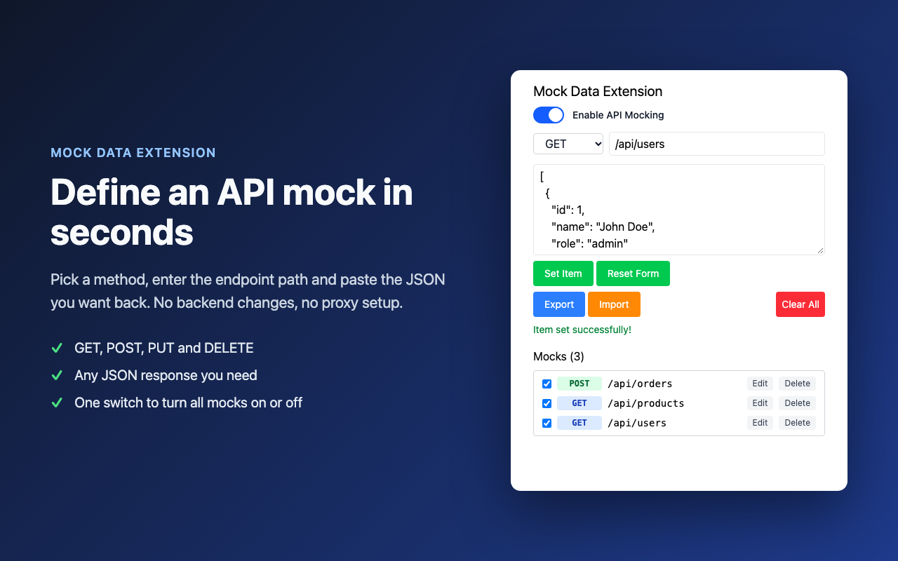

# Mock Data Extension

A Chrome extension that returns your own JSON for chosen API endpoints. Build and test a
frontend before the backend is ready, reproduce edge cases, or demo an app without a live server.

**[Install from the Chrome Web Store](https://chromewebstore.google.com/detail/mock-data-extension/fdlfbgjbacfoflclbncmildgjhngcjmb)**



## Features

- Mock any endpoint by HTTP method (`GET`, `POST`, `PUT`, `DELETE`) and URL path
- Works on any site, including `localhost`
- Exact path matching, with `*` wildcards for groups of paths
- One switch turns all mocks on or off; each mock can also be turned off individually
- Export / import mocks as a JSON file
- Everything is stored locally in the browser — see [PRIVACY.md](PRIVACY.md)

## Usage

1. Click the extension icon to open the popup.
2. Choose the method, enter the endpoint path (e.g. `/api/users`) and paste the JSON response.
3. Click **Set Item**.
4. Turn on **Enable API Mocking**.
5. Reload the page — matching `fetch` / `XMLHttpRequest` requests now return your JSON with status 200.

Saved mocks are listed below the form. In the list you can:

- turn a single mock on or off with its checkbox, without deleting it;
- **Edit** a mock — it is loaded into the form; **Save Changes** updates it (changing the method or path moves it), **Cancel** leaves it as is;
- **Delete** a mock.

**Clear All** deletes everything. The **Enable API Mocking** switch turns all mocks on or off at once.

### How paths are matched

The request URL path must **end with** the mock path. Any host or base path before it is allowed,
and the query string is ignored.

| Mock path | URL | Result |
|-----------|-----|--------|
| `/api/users` | `https://example.com/api/users` | mocked |
| `/api/users` | `http://localhost:3000/v1/api/users?page=2` | mocked |
| `/api/users` | `https://example.com/api/users/1` | real response |
| `/api/users/*` | `https://example.com/api/users/42` | mocked |

The method must match too: a `GET` mock does not affect `POST` requests to the same path.

### Import / export format

A JSON object where each key is `METHOD:/path` and the value is the response body:

```json
{
  "GET:/api/users": [{ "id": 1, "name": "John Doe" }],
  "POST:/api/orders": { "id": 1042, "status": "created" }
}
```

Keys without a method prefix are imported as `GET`.

## Development

Requires Node.js and npm.

```bash
npm install
npm run build
```

Then load the extension:

1. Open `chrome://extensions` and turn on **Developer mode**.
2. Click **Load unpacked** and select the `dist` folder.
3. After each rebuild, click the reload button on the extension card.

`npm run lint` runs ESLint. To inspect the active mock rules, open the extension's service worker
from `chrome://extensions` and run `await chrome.declarativeNetRequest.getDynamicRules()`.

`examples/example.html` is a small page for trying requests by hand.

### Project structure

```
public/
  manifest.json      Manifest V3
  background.js      Service worker: turns saved mocks into request redirect rules
  icons/
src/
  App.tsx            Popup UI (React)
  helpers/           Storage operations, import/export
  store/             Popup form state
store-assets/        Chrome Web Store screenshots and their generator
CHROMEWEBSTORE.md    Store listing copy, permission justifications, version history
PRIVACY.md           Privacy policy
```

## Releasing to the Chrome Web Store

1. Bump `version` in `public/manifest.json` (and `package.json`) — the store rejects a version
   it has already seen.
2. Add an entry to **Version History** in [CHROMEWEBSTORE.md](CHROMEWEBSTORE.md).
3. Build and package the contents of `dist/` (the zip must have `manifest.json` at its root):

   ```bash
   npm run build && (cd dist && zip -qr -X ../mock-data-extension-$(node -p "require('./manifest.json').version").zip . -x '.*')
   ```

4. If the popup UI changed, regenerate the 1280×800 screenshots with
   `./store-assets/generate.sh` (uses the locally installed Google Chrome in headless mode).
5. Upload the zip in the Chrome Developer Dashboard and submit for review.
